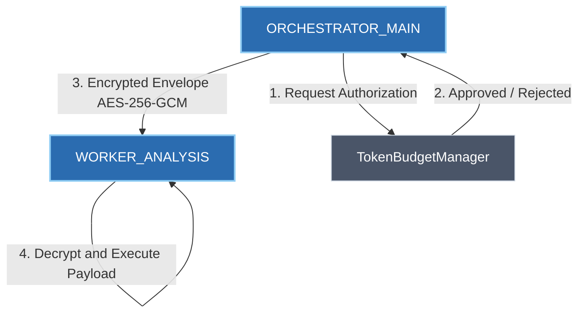

# ⚡ NEXUS-C2: Zero-Trust Multi-Agent C2 Architecture

> **NEXUS-C2** to zdecentralizowana platforma orkiestracji autonomicznych agentów wykorzystująca zasady **Zero-Trust**, kryptograficzne szyfrowanie wiadomości (**Envelope Encryption / AES-256-GCM**) oraz silnik **Deterministycznego Budżetowania Tokenów/Kontekstu**.

---

## ✨ Kluczowe Funkcjonalności

- **Zero-Trust Envelope Encryption:** Bezpieczne pakowanie ładunku wiadomości w szyfrowane koperty z unikalnym kluczem roboczym (DEK/KEK Pattern, `cryptography`).
- **Deterministic Token & Cost Budgeting:** Rygorystyczna weryfikacja kosztów finansowych oraz limitów tokenów przed przekazaniem egzekucji do agenta LLM.
- **Multi-Agent DAG Flow Orchestration:** Sekwencyjne dispatchowanie zadań między rolami (Orchestrator, Worker, Auditor) w oparciu o autoryzowane przydziały.
- **Rich Interactive CLI:** Konsolowy interfejs raportujący stan szyfrowania, budżetów oraz wyników orkiestracji (`Rich` + `Typer`).

---

## 🏗️ Architektura Przepływu Zadań

